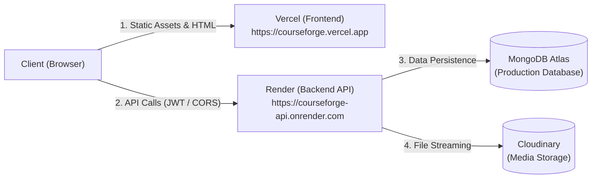

# CourseForge Production Deployment Guide

This guide covers deploying **CourseForge** to production using:
- **Frontend**: [Vercel](https://vercel.com) (React 19 + Vite 8 SPA)
- **Backend API**: [Render](https://render.com) (Node.js + Express 5)
- **Database**: [MongoDB Atlas](https://www.mongodb.com/cloud/atlas) (Free M0 Shared Cluster)
- **Media Storage (Optional)**: [Cloudinary](https://cloudinary.com) (For production thumbnail & video hosting)

---

## Architecture Overview



---

## Step 1: Set Up MongoDB Atlas (Database)

1. Create a free account at [mongodb.com/cloud/atlas](https://www.mongodb.com/cloud/atlas).
2. Create a new cluster (select **M0 Free Tier**, AWS or Google Cloud, nearest region e.g. Singapore or Mumbai).
3. Under **Security &rarr; Database Access**:
   - Add a new database user (e.g. `courseforge_admin` with a secure password).
4. Under **Security &rarr; Network Access**:
   - Click **Add IP Address** &rarr; Select **Allow Access from Anywhere (`0.0.0.0/0`)** (required for Render's dynamic outbound IPs).
5. Click **Connect &rarr; Drivers &rarr; Node.js**:
   - Copy the connection string:
     ```text
     mongodb+srv://courseforge_admin:<password>@cluster0.abcde.mongodb.net/courseforge?retryWrites=true&w=majority
     ```
   - Replace `<password>` with your database user password.

---

## Step 2: Deploy Backend to Render

### Option A: Using Render Blueprint (`render.yaml`) — Recommended
1. Log in to [dashboard.render.com](https://dashboard.render.com).
2. Click **New + &rarr; Blueprint**.
3. Connect your **CourseForge** GitHub repository.
4. Render will read `render.yaml` and prefill the service configuration:
   - Name: `courseforge-api`
   - Root Directory: `server`
   - Runtime: `Node`
   - Build Command: `npm install`
   - Start Command: `npm start`
5. Fill in the requested secret variables:
   - `MONGO_URI`: Your MongoDB Atlas connection string from Step 1.
   - `ADMIN_PASSWORD`: A secure password for your initial instructor/admin user.
   - `CLIENT_ORIGIN`: Your anticipated Vercel URL (e.g. `https://courseforge.vercel.app`) or leave default until Step 3.
6. Click **Apply**. Render will build and deploy the web service.
7. Once deployed, note your service URL (e.g. `https://courseforge-api.onrender.com`).

### Option B: Manual Web Service Setup on Render
1. Click **New + &rarr; Web Service**.
2. Connect your **CourseForge** repository.
3. Configure settings:
   - **Name**: `courseforge-api`
   - **Root Directory**: `server`
   - **Environment**: `Node`
   - **Build Command**: `npm install`
   - **Start Command**: `npm start`
   - **Plan**: `Free`
4. Add Environment Variables:
   | Key | Value | Notes |
   | :--- | :--- | :--- |
   | `NODE_ENV` | `production` | Enables secure cookies & optimized error handling |
   | `PORT` | `10000` | Render default port |
   | `MONGO_URI` | `mongodb+srv://...` | From Step 1 |
   | `JWT_SECRET` | *Click Generate or enter 64-char string* | Cryptographic signing key |
   | `JWT_EXPIRE` | `15m` | Short-lived access token |
   | `JWT_REFRESH_EXPIRE` | `7d` | Long-lived refresh token |
   | `CLIENT_ORIGIN` | `https://your-app.vercel.app` | Comma-separated allowed frontend origins |
   | `ADMIN_NAME` | `Admin` | Initial instructor account |
   | `ADMIN_EMAIL` | `admin@courseforge.dev` | Initial instructor email |
   | `ADMIN_PASSWORD` | `YourSecurePassword123` | Initial instructor password |
   | `CLOUDINARY_CLOUD_NAME` | *(Optional)* | Cloudinary cloud name |
   | `CLOUDINARY_API_KEY` | *(Optional)* | Cloudinary API key |
   | `CLOUDINARY_API_SECRET` | *(Optional)* | Cloudinary API secret |

---

## Step 3: Seed the Initial Production Admin

Once your Render service is live:
1. In the Render Dashboard, go to your `courseforge-api` service.
2. Click the **Shell** tab on the left navigation bar.
3. Run:
   ```bash
   npm run seed:admin
   ```
4. You should see:
   ```text
   Admin user created successfully!
   Email: admin@courseforge.dev
   Role: admin
   ```

---

## Step 4: Deploy Frontend to Vercel

1. Log in to [vercel.com](https://vercel.com).
2. Click **Add New... &rarr; Project**.
3. Import your **CourseForge** repository from GitHub.
4. Configure Project Settings:
   - **Framework Preset**: `Vite`
   - **Root Directory**: Click *Edit* and select `client` &rarr; Click *Continue*.
   - **Build Command**: `npm run build` (default)
   - **Output Directory**: `dist` (default)
   - **Install Command**: `npm install` (default)
5. Expand **Environment Variables** and add:
   | Key | Value | Notes |
   | :--- | :--- | :--- |
   | `VITE_API_URL` | `https://courseforge-api.onrender.com` | **Your Render backend URL from Step 2** |
   | `VITE_USE_MOCK` | `false` | **CRITICAL: Disables mock mode and connects to live MongoDB backend** |
   | `VITE_BASE_PATH` | `/` | Root URL serving |
6. Click **Deploy**.
7. Vercel will build the frontend in ~30 seconds and provide your live URL (e.g. `https://courseforge.vercel.app`).

---

## Step 5: Final Cross-Origin Check

1. In your **Render Dashboard** &rarr; `courseforge-api` &rarr; **Environment**:
   - Ensure `CLIENT_ORIGIN` contains your live Vercel URL (e.g., `CLIENT_ORIGIN=https://courseforge.vercel.app`).
   - Note: The backend CORS middleware automatically allows all `*.vercel.app` subdomains in production.
2. Visit your Vercel URL in a browser:
   - Open Developer Tools (`F12` &rarr; Network tab).
   - Sign in using your seeded admin credentials (`admin@courseforge.dev`).
   - Confirm requests return `200 OK` from your Render backend API.
   - Navigate to the **Instructor Tools** / **Admin** panel to create courses and quizzes.
